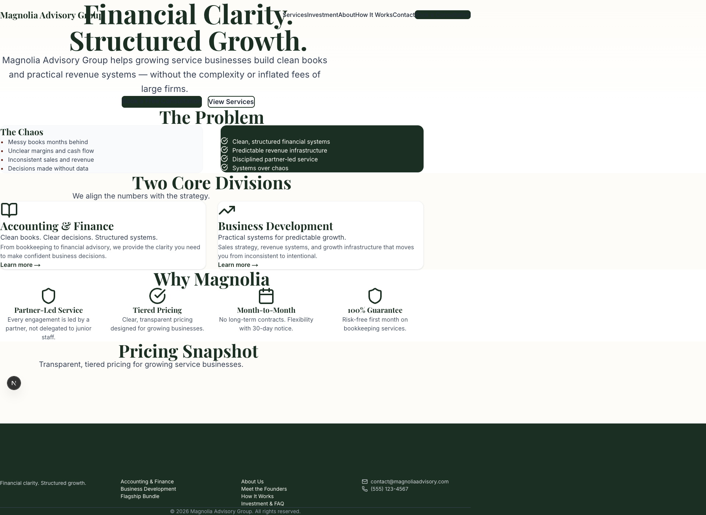
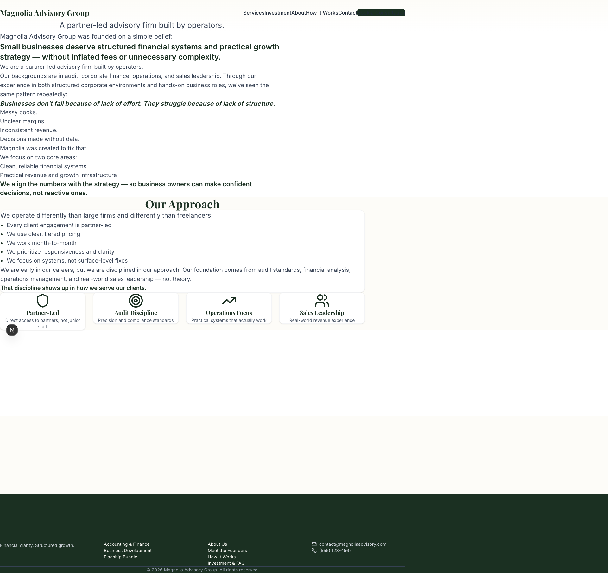
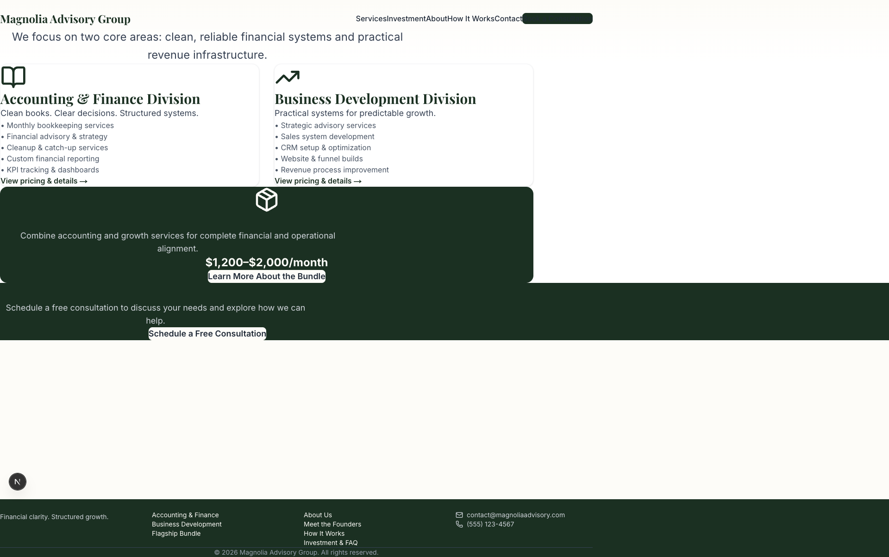
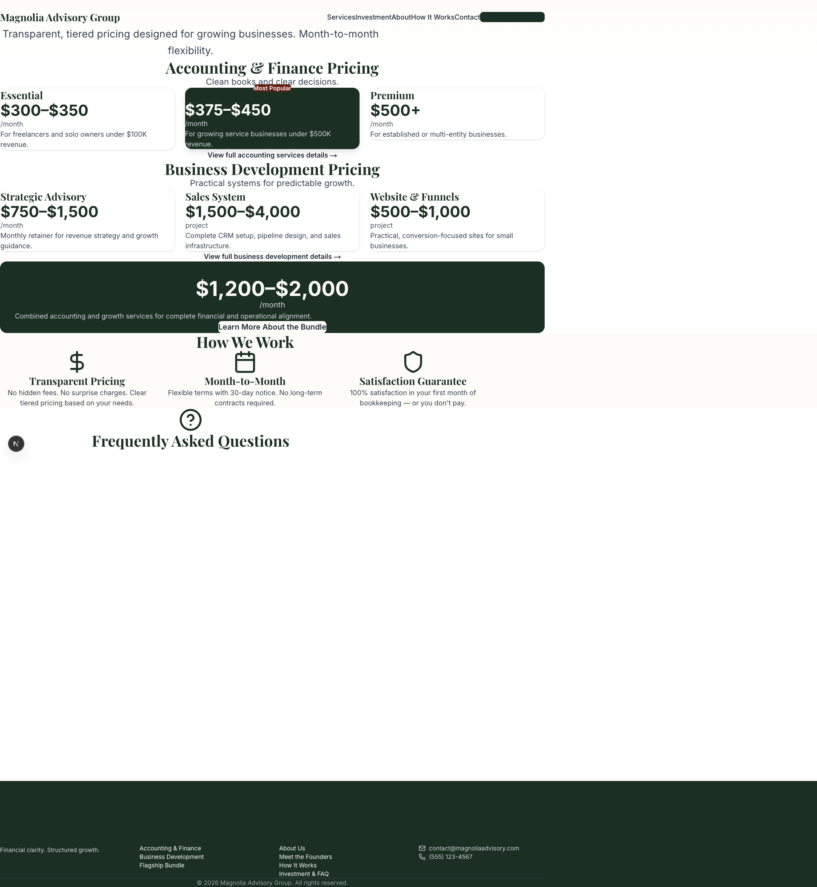
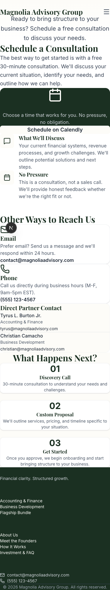

# Critical Styling Issues - Visual Guide

## 🔴 Issue #1: Navigation Menu Concatenation

**All Pages - Desktop View**

**Problem:** Navigation items are running together without spaces:
- Shows: "ServicesInvestmentAboutHow It WorksContact"
- Should show: "Services | Investment | About | How It Works | Contact"

**Location in Code:** Likely in the header/navigation component
**Fix Required:** Add proper spacing, separators, or individual menu items

---

## 🔴 Issue #2: Excessive White Space

### About Page

### Services Page

**Problem:** 
- More than 50% of the page is empty white space
- Content appears to end abruptly
- Makes pages look unfinished

**Fix Required:**
- Add more content sections
- Reduce bottom padding/margins
- Add testimonials, FAQs, or other content

---

## 🔴 Issue #3: Missing FAQ Content

### Investment/Pricing Page

**Problem:**
- "Frequently Asked Questions" heading appears
- No FAQ content is visible below it
- Followed by massive white space

**Fix Required:**
- Implement FAQ accordion component
- Add actual FAQ questions and answers
- Or remove the heading if FAQs aren't ready

---

## 🟡 Issue #4: Mobile Navigation

### Homepage Mobile

**Problem:**
- Mobile menu exists (hamburger icon visible)
- But navigation text still shows concatenation issue
- Need to verify mobile menu functionality

**Fix Required:**
- Ensure mobile menu opens properly
- Fix spacing in mobile menu items
- Test on actual mobile devices

---

## 🟡 Issue #5: Button Spacing

### Homepage Hero Section

**Problem:**
- "Get Started" and "View Services" buttons appear too close
- Dark backgrounds make them hard to distinguish
- Could benefit from better visual hierarchy

**Fix Required:**
- Add gap between buttons (gap-4 or gap-6)
- Use different button styles (primary vs secondary)
- Improve contrast and spacing

---

## 📱 Mobile Responsiveness Check

### Mobile Views Look Generally Good:

**Homepage Mobile:**

✅ Content stacks properly
✅ Text is readable
⚠️ Navigation needs fixing

**Contact Mobile:**

✅ Form elements stack well
✅ Process steps layout works
✅ Contact info is clear

**Founders Mobile:**

✅ Images display properly
✅ Text wraps correctly
⚠️ Very long page - consider optimization

---

## 🎯 Quick Fix Checklist

- [ ] Fix navigation menu spacing (all pages)
- [ ] Reduce white space on About page
- [ ] Reduce white space on Services page
- [ ] Add FAQ content or remove heading on Investment page
- [ ] Test and fix mobile navigation
- [ ] Improve button spacing on homepage
- [ ] Add missing image: /images/tyrus-burton.png
- [ ] Test all pages on actual mobile devices
- [ ] Run accessibility audit
- [ ] Optimize images for performance

---

## 📊 Pages Tested

✅ Homepage - `/`
✅ About - `/about`
✅ Services - `/services`
✅ Services/Growth - `/services/growth`
✅ Services/Accounting - `/services/accounting`
✅ Investment/Pricing - `/investment`
✅ How It Works - `/how-it-works`
✅ Contact - `/contact`
✅ Founders - `/founders`
✅ Bundle - `/bundle`

**Total:** 10 pages tested in both desktop and mobile views (20 screenshots)

---

## 🔗 Full Report

See [STYLING-ISSUES-REPORT.md](./STYLING-ISSUES-REPORT.md) for complete details on all issues found, including minor issues and enhancement recommendations.
